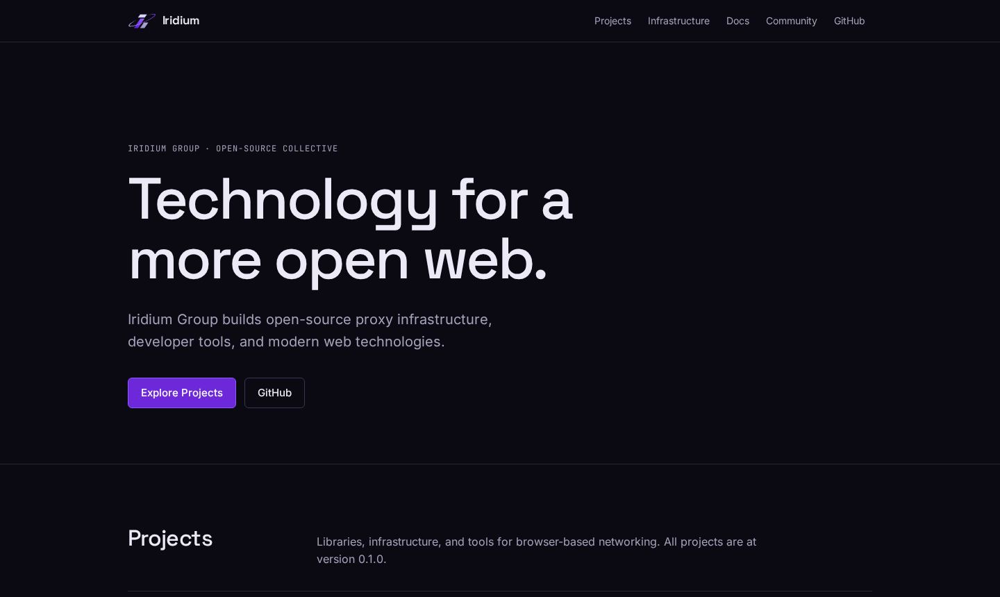

<p align="center"></p>

<h1 align="center">iridium</h1>

<p align="center">
  The Iridium Group website and the shared Iridium UI kit.
</p>

<p align="center">
  <a href="https://github.com/Iridium-Group/iridium/actions/workflows/ci.yml"></a>
  <a href="./LICENSE"></a>
</p>

Iridium Group is an independent open-source technology collective focused on building fast,
reliable, and accessible web infrastructure. This repository holds the organization website, a
static Astro site, and the `ui/` folder of design tokens and components that other Iridium sites
reuse.

Status: **Development**. The site is deployed via GitHub Pages to
https://iridium-group.github.io/iridium/ once Pages is enabled for this repository.



## Pages

| Path                       | Content                                                           |
| -------------------------- | ----------------------------------------------------------------- |
| `/iridium/`                | Introduction, featured projects, architecture, and principles.    |
| `/iridium/projects/`       | Every Iridium repository with status, license, and tech.          |
| `/iridium/infrastructure/` | The core, client, transport, and infrastructure layers, and Wisp. |
| `/iridium/community/`      | Issues, discussions, contributing, conduct, and security.         |
| `404.html`                 | Not found page, served by GitHub Pages for unknown paths.         |

Project data lives in one file, `src/data/projects.ts`. Status labels and their definitions live
in `ui/status.ts`.

## Development

Requires Node.js 22.23.4 or later and npm.

```sh
git clone https://github.com/Iridium-Group/iridium.git
cd iridium
npm ci
npm run dev
```

The dev server prints a local URL; the site is served under the `/iridium/` base path.

| Command                | What it does                                                                 |
| ---------------------- | ---------------------------------------------------------------------------- |
| `npm run dev`          | Start the Astro dev server.                                                  |
| `npm run build`        | Build the static site into `dist/`.                                          |
| `npm run preview`      | Serve the built site locally.                                                |
| `npm run typecheck`    | Run `astro check` (TypeScript and Astro diagnostics).                        |
| `npm run check:links`  | Verify every internal link and asset in `dist/` resolves. Run after `build`. |
| `npm run format`       | Format files with Prettier.                                                  |
| `npm run format:check` | Check formatting without writing.                                            |

## Project layout

```text
ui/                  Shared Iridium UI kit (tokens, base styles, components)
src/data/            Site settings and the projects list
src/components/      Site-specific components (architecture diagram)
src/layouts/         Page shell: head tags, nav, footer
src/pages/           One file per route
public/              Favicon, mark, and Open Graph image
scripts/             check-links.mjs
```

See [ui/README.md](./ui/README.md) for what the UI kit contains and how other sites use it.

## Deployment

`.github/workflows/deploy.yml` builds the site on every push to `main` and publishes `dist/` with
`actions/deploy-pages`. To enable it, set **Settings > Pages > Source** to **GitHub Actions**.

## Accessibility

The site uses semantic landmarks, a skip link, visible focus outlines, and colors chosen to meet
WCAG AA contrast on the dark background. Smooth scrolling and transitions are turned off when the
visitor prefers reduced motion. Layouts are checked at 360 px and 1440 px wide.

## Dependencies

| Package                       | Purpose                    | License    |
| ----------------------------- | -------------------------- | ---------- |
| `astro`                       | Static site framework      | MIT        |
| `@fontsource/inter`           | Self-hosted Inter          | OFL-1.1    |
| `@fontsource/space-grotesk`   | Self-hosted Space Grotesk  | OFL-1.1    |
| `@fontsource/jetbrains-mono`  | Self-hosted JetBrains Mono | OFL-1.1    |
| `@astrojs/check` (dev)        | Type and template checks   | MIT        |
| `typescript` (dev)            | Type checking              | Apache-2.0 |
| `prettier` (dev)              | Formatting                 | MIT        |
| `prettier-plugin-astro` (dev) | Formatting `.astro` files  | MIT        |

## Acknowledgements

The infrastructure page describes Iridium's use of open-source projects by Mercury Workshop:
[Scramjet](https://github.com/MercuryWorkshop/scramjet) (MIT),
[wisp-js](https://github.com/MercuryWorkshop/wisp-js) (LGPL-3.0-or-later), and
[epoxy-transport](https://github.com/MercuryWorkshop/epoxy-transport) (AGPL-3.0-only). This
website does not depend on them.

## Contributing

See [CONTRIBUTING.md](./CONTRIBUTING.md). Security issues: use GitHub private vulnerability
reporting on this repository's Security tab.

## License

[MIT](./LICENSE). Copyright 2026 Iridium Group contributors. The Iridium mark is the
organization's logo; fonts are under the SIL Open Font License 1.1.
